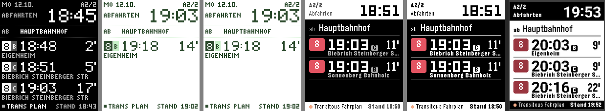
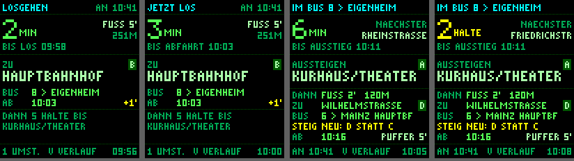
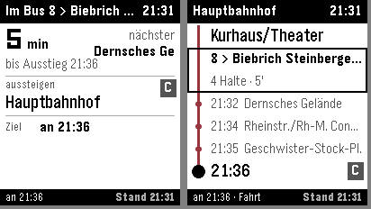
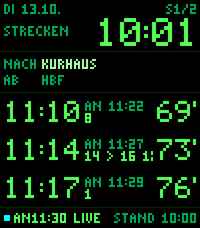

# Linie 8 — Bus und Bahn am Handgelenk


Abfahrten, Verbindungen und die laufende Fahrt auf der **Pebble Time 2**: mit Umstiegen und Fußwegen, live vom
RMV und der DB. Das Handy kann in der Tasche bleiben.

Angefangen hat die App als Anzeige für die Buslinie 8 in Wiesbaden. Fahrpläne kommen heute deutschlandweit über
Transitous, Echtzeit im Rhein-Main-Gebiet vom RMV und für Züge bundesweit von der DB.

> **Beta, Version 0.12.0.** Geprüft mit Tests gegen Live-Daten und im Emulator. Der Alltagstest auf der Uhr läuft
> noch.



*Abfahrten in den vier Ansichten Phosphor weiß und grün, Klar und Papier, teils invertiert und mit hohem Kontrast.*

## Was sie kann

- **Abfahrten**: deine Haltestellen mit den nächsten Abfahrten, Steig und Restminuten. Mit Ausstieg nur die
  Fahrten, die wirklich dorthin fahren, samt Ankunftszeit
- **Strecken**: vom Standort oder einem Favoriten zum Ziel, mit Umstiegen und Fußwegen. Die App zeigt, wann du
  **losgehen** musst
- **Ankommen um** *(neu)*: Zielzeit wählen, die App zeigt die letzten Verbindungen, mit denen du rechtzeitig da bist
- **Aktive Fahrt**: eine Verbindung starten, und die Uhr führt dich Schritt für Schritt durch Losgehen, Einsteigen,
  nächsten Halt, Aussteigen und Umsteigen. Zeiten und Steigwechsel live
- **Anschluss wackelt**: Bei einem knappen Umstieg weckt sich die Uhr und fragt nach. Ist der Anschluss weg, sucht
  sie eine neue Verbindung ab dem Umstieg
- **Früher da**: Gibt es eine Verbindung, die deutlich früher ankommt, schlägt die App sie von selbst vor.
  Ausfälle meldet sie sofort
- **Spontan**: Abfahrten und Strecken ab dem Standort, ohne vorher etwas anzulegen
- **Rückfahrt** mit einem Klick, **20 Favoriten**, Suche an der Uhr per Haltestelle A–Z oder Diktat
- **Echtzeit**: Verspätungen, Ausfälle, Steig vom RMV, für Züge bundesweit von der **Deutschen Bahn**. Ohne Schlüssel läuft die App mit dem Fahrplan
- **Vier Ansichten**: Klar, Papier, Phosphor grün und weiß, jeweils auch invertiert und mit hohem Kontrast
- **Lange Namen** laufen durch, statt abgeschnitten zu werden
- **Alles an der Uhr einstellbar**, oder bequemer in der Pebble-App am Handy

## Unterwegs



*Aktive Fahrt in Phosphor: losgehen, jetzt los, im Bus, zwei Halte vor dem Ausstieg.*

<p>
  
  &nbsp;
  
</p>

*Links dieselbe Fahrt in Klar: aktueller Schritt und Verlauf. Rechts **Ankommen um 11:30**: die drei letzten
passenden Verbindungen, unten die Zielzeit.*

## Installation

1. `linie8.pbw` aus dem neuesten Eintrag unter [Releases](../../releases) laden
2. Am Android-Handy mit der Pebble-App (Core Devices) öffnen, sie installiert die App auf der Uhr
3. App öffnen, **Select lang** drücken, `NEU ANLEGEN`

Nur für **emery** gebaut (Pebble Time 2, 200 × 228 Pixel).

### Echtzeit freischalten

Optional. Die Schlüssel kommen in die Pebble-App am Handy (*Linie 8 › Einstellungen › Datenquelle*) und bleiben
dort. Sie stehen nie im Code und nie in der `.pbw`.

| Quelle | Liefert | Schlüssel |
| --- | --- | --- |
| [RMV Open Data](https://www.rmv.de/s/de/rmv-open-data) | Bus, Tram und Bahn im Rhein-Main-Gebiet live | kostenlos, `accessId` |
| [DB Timetables](https://developers.deutschebahn.com) | Züge bundesweit live: Verspätung, Gleis, Ausfall | kostenlos, Client-ID und API-Key |
| [Transitous](https://transitous.org) | Fahrplan deutschlandweit, Rückfall ohne Schlüssel | keiner |

**RMV:** bei [RMV Open Data](https://www.rmv.de/s/de/rmv-open-data) registrieren und einen Schlüssel (`accessId`)
beantragen. In der App eintragen, *Schlüssel prüfen*, *Speichern*.

**Deutsche Bahn:** im [DB API Marketplace](https://developers.deutschebahn.com) kostenlos registrieren, eine Anwendung
anlegen und darin die API **Timetables** abonnieren. Client-ID und API-Key unter *Datenquelle › DB-Echtzeit für Züge*
eintragen, *DB-Zugang prüfen*, *Speichern*. Die DB ergänzt RMV bzw. Transitous: Für Züge an DB-Bahnhöfen kommen
Verspätung, Gleis und Ausfälle von dort, unten auf der Uhr steht dann `RMV+DB` bzw. „RMV + DB live“.

## Bedienung

| Taste | Wirkung |
| --- | --- |
| Hoch / Runter | Seite wechseln, **lang**: zwischen Abfahrten und Strecken |
| Select | Details zur Abfahrt oder Verbindung, dort `FAHRT STARTEN` |
| Select lang | Menü zu dem, was gerade zu sehen ist |
| Zurück | eine Ebene zurück |

Der Touchscreen geht auch: Wischen blättert, Tippen wählt.

## Selbst bauen

Voraussetzungen: `pebble-tool` 5.0 mit SDK 4.33, Node.js für die Tests, `cc` für die Vorschau.

```bash
tools/bauen.sh          # Ergebnis in dist/linie8.pbw
tools/bauen.sh emu      # im Emulator starten
tools/bauen.sh uhr <IP> # übers Handy auf die Uhr
```

| Werkzeug | Zweck |
| --- | --- |
| `tools/vorschau/` | Nachbau von `pebble.h`: rendert `main.c` auf dem Mac als PNG, ohne SDK |
| `tools/test/*_test.js` | spielen Menü, Strecken, Fahrt und Einstellungsseite in Node mit Live-Daten durch |

Code, Kommentare und Bezeichner sind deutsch. Auf der Uhr läuft C, auf dem Handy PebbleKit JS, das alle Abfragen
übernimmt und der Uhr nur fertige Zeilen schickt.

## Daten und Dank

- [RMV Open Data](https://www.rmv.de/s/de/rmv-open-data): HAFAS-ReST-Schnittstelle mit Echtzeit
- [Transitous](https://transitous.org): freie, gemeinschaftlich betriebene MOTIS-Schnittstelle mit Fahrplänen von
  DELFI. Bitte schonend nutzen
- [DB Timetables](https://developers.deutschebahn.com): Echtzeit für Züge
- [db-stations](https://github.com/derhuerst/db-stations): Bahnhofsliste, CC BY 4.0
- Roboto (Apache 2.0) für die Ziffern der Ansicht Papier
- Pebble SDK und Pebble-App von Core Devices und Rebble

Gemacht von **Seb & Claude** (Anthropic): Ideen, Entscheidungen und Alltagstest von Seb, Code, Tests und
Dokumentation von Claude.

## Lizenz

MIT, siehe [LICENSE](LICENSE).
