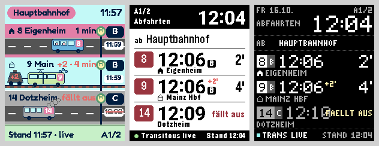
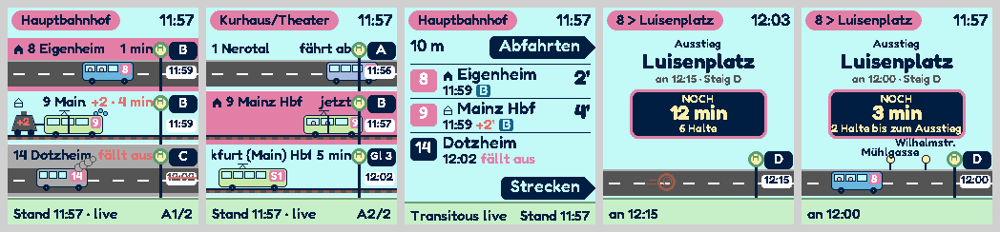
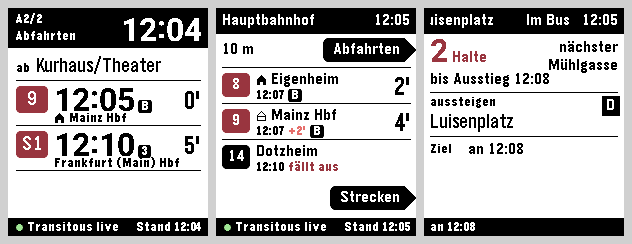
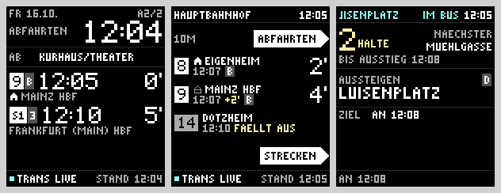
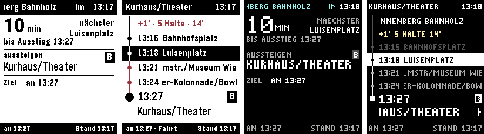
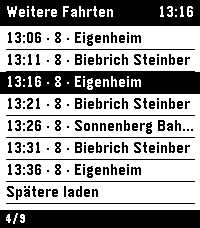

# Linie 8 — Bus und Bahn am Handgelenk


Abfahrten, Verbindungen und die laufende Fahrt auf der **Pebble Time 2**: mit Umstiegen und Fußwegen, live vom
RMV und der DB. Das Handy kann in der Tasche bleiben.

Angefangen hat die App als Anzeige für die Buslinie 8 in Wiesbaden. Fahrpläne kommen heute deutschlandweit über
Transitous, Echtzeit im Rhein-Main-Gebiet vom RMV und für Züge bundesweit von der DB.

> **Beta, Version 0.17.1.** Geprüft mit Tests gegen Live-Daten und im Emulator. Der Alltagstest auf der Uhr läuft
> noch.



*Abfahrten am Hauptbahnhof in den drei Ansichten Cartoon (Standard), Papier und Phosphor.*

## Was sie kann

- **Startseite** *(neu)*: beim Öffnen die nächste Haltestelle mit ihren Abfahrten, Hoch führt zu den Abfahrten,
  Runter zu den Strecken
- **Heimathaltestelle** *(neu)*: ein Haus an jeder Abfahrt, die später dort hält, ein leeres Haus, wenn sie nur in
  der Nähe vorbeikommt
- **Abfahrten**: deine Haltestellen mit den nächsten Abfahrten, Steig und Restminuten. Mit Ausstieg nur die
  Fahrten, die wirklich dorthin fahren, samt Ankunftszeit
- **Strecken**: vom Standort oder einem Favoriten zum Ziel, mit Umstiegen und Fußwegen. Die App zeigt, wann du
  **losgehen** musst
- **Ankommen um**: Zielzeit wählen, die App zeigt die letzten Verbindungen, mit denen du rechtzeitig da bist
- **Weitere Fahrten** *(neu)*: frühere und spätere Abfahrten bzw. Verbindungen als Liste. Sitzt du schon im Bus,
  wählst du hier die laufende Fahrt und startest sie
- **Aktive Fahrt**: eine Verbindung starten, und die Uhr führt dich Schritt für Schritt durch Losgehen, Einsteigen,
  nächsten Halt, Aussteigen und Umsteigen. Zeiten und Steigwechsel live. Im Verlauf markiert ein Balken den nächsten
  Halt, auch mit allen Zwischenhalten
- **Anschluss wackelt**: Bei einem knappen Umstieg weckt sich die Uhr und fragt nach. Ist der Anschluss weg, sucht
  sie eine neue Verbindung ab dem Umstieg
- **Früher da**: Gibt es eine Verbindung, die deutlich früher ankommt, schlägt die App sie von selbst vor.
  Ausfälle meldet sie sofort
- **Spontan**: Abfahrten und Strecken ab dem Standort, ohne vorher etwas anzulegen
- **Rückfahrt** mit einem Klick, **20 Favoriten**, Suche an der Uhr per Haltestelle A–Z oder Diktat
- **Echtzeit**: Verspätungen, Ausfälle, Steig vom RMV, für Züge bundesweit von der **Deutschen Bahn**. Ohne Schlüssel läuft die App mit dem Fahrplan
- **Drei Ansichten**: **Cartoon** *(neu, Standard)* — jede Abfahrt eine Straße oder ein Gleis, Bus, Tram oder Zug
  fährt ins Bild; Papier (fette Systemschrift) und Phosphor (Pixelschrift), beide auch invertiert, Phosphor
  zusätzlich mit hohem Kontrast
- **Aktualisieren** *(neu)*: regelmäßig, nach jeder Abfahrt, und wie lange ohne Tastendruck
- **Lange Namen** laufen überall durch, statt abgeschnitten zu werden
- **Alles an der Uhr einstellbar**, nach Rubriken geordnet, oder bequemer in der Pebble-App am Handy

## Ansicht Cartoon



*Abfahrten am Hauptbahnhof und am Kurhaus, Startseite, Fahrt im Bus mit 12 und 3 Minuten bis zum Ausstieg.*

- Jede Abfahrt bekommt eine Straße (Bus) oder ein Gleis (Tram mit Gelenk und Stromabnehmer, Zug länger, Schild `Gl`)
- Das Fahrzeug fährt bei 10 Minuten links ins Bild. Seine Front erreicht den Mast genau in dem Moment, in dem die Uhr
  auf die Abfahrtszeit springt
- **Verspätung**: Der Bus schwitzt und zieht ein Gewicht mit `+2`. **Ausfall**: Panne mit Rauch, die Zeit ist
  durchgestrichen
- **In der Fahrt**: der Ausstieg groß, die Minuten auf einer Tafel. Ab 5 Minuten fährt das Fahrzeug auf den Ausstieg
  zu, die letzten Halte stehen an der Straße. In der letzten Minute steht `JETZT RAUS!` da und die Uhr vibriert
- **Rosa** sind alle Abfahrten, die später an deiner Heimathaltestelle halten. Die Auswahl (Select öffnet ihre
  Details) trägt einen dunklen Rahmen
- Neu gezeichnet wird alle 5 Sekunden

## Papier und Phosphor





*Abfahrten am Kurhaus, Startseite und Fahrt im Bus, oben Papier, unten Phosphor.*

## Unterwegs



*Aktive Fahrt vom Hauptbahnhof zum Kurhaus, im Bus: Fahrtkarte und Verlauf mit dem Balken auf dem nächsten Halt,
links Papier, rechts Phosphor.*



*Weitere Fahrten: die Auswahl steht auf der nächsten Abfahrt, darüber die eben abgefahrenen.*

## Installation

1. `linie8.pbw` aus dem neuesten Eintrag unter [Releases](../../releases) laden
2. Am Android-Handy mit der Pebble-App (Core Devices) öffnen, sie installiert die App auf der Uhr
3. App öffnen, **Select lang** drücken, `NEU ANLEGEN`

Nur für **emery** gebaut (Pebble Time 2, 200 × 228 Pixel).

### Echtzeit freischalten

Optional. Die Schlüssel kommen in die Pebble-App am Handy (*Linie 8 › Einstellungen › Datenquelle*) und bleiben
dort. Sie stehen nie im Code und nie in der `.pbw`.

| Quelle | Liefert | Schlüssel |
| --- | --- | --- |
| [RMV Open Data](https://www.rmv.de/s/de/rmv-open-data) | Bus, Tram und Bahn im Rhein-Main-Gebiet live | kostenlos, `accessId` |
| [DB Timetables](https://developers.deutschebahn.com) | Züge bundesweit live: Verspätung, Gleis, Ausfall | kostenlos, Client-ID und API-Key |
| [Transitous](https://transitous.org) | Fahrplan deutschlandweit, Rückfall ohne Schlüssel | keiner |

**RMV:** bei [RMV Open Data](https://www.rmv.de/s/de/rmv-open-data) registrieren und einen Schlüssel (`accessId`)
beantragen. In der App eintragen, *Schlüssel prüfen*, *Speichern*.

**Deutsche Bahn:** im [DB API Marketplace](https://developers.deutschebahn.com) kostenlos registrieren, eine Anwendung
anlegen und darin die API **Timetables** abonnieren. Client-ID und API-Key unter *Datenquelle › DB-Echtzeit für Züge*
eintragen, *DB-Zugang prüfen*, *Speichern*. Die DB ergänzt RMV bzw. Transitous: Für Züge an DB-Bahnhöfen kommen
Verspätung, Gleis und Ausfälle von dort, unten auf der Uhr steht dann `RMV+DB` bzw. „RMV + DB live“.

## Bedienung

| Taste | Wirkung |
| --- | --- |
| Hoch / Runter | Seite wechseln, **lang**: zwischen Abfahrten und Strecken |
| Select | Details zur Abfahrt oder Verbindung, dort `FAHRT STARTEN` |
| Select lang | Menü zu dem, was gerade zu sehen ist |
| Zurück | eine Ebene zurück |

Der Touchscreen geht auch: Wischen blättert, Tippen wählt.

## Selbst bauen

Voraussetzungen: `pebble-tool` 5.0 mit SDK 4.33, Node.js für die Tests, `cc` für die Vorschau.

```bash
tools/bauen.sh          # Ergebnis in dist/linie8.pbw
tools/bauen.sh emu      # im Emulator starten
tools/bauen.sh uhr <IP> # übers Handy auf die Uhr
```

| Werkzeug | Zweck |
| --- | --- |
| `tools/vorschau/` | Nachbau von `pebble.h`: rendert `main.c` auf dem Mac als PNG, ohne SDK |
| `tools/test/*_test.js` | spielen Menü, Strecken, Fahrt und Einstellungsseite in Node mit Live-Daten durch |

Code, Kommentare und Bezeichner sind deutsch. Auf der Uhr läuft C, auf dem Handy PebbleKit JS, das alle Abfragen
übernimmt und der Uhr nur fertige Zeilen schickt.

## Daten und Dank

- [RMV Open Data](https://www.rmv.de/s/de/rmv-open-data): HAFAS-ReST-Schnittstelle mit Echtzeit
- [Transitous](https://transitous.org): freie, gemeinschaftlich betriebene MOTIS-Schnittstelle mit Fahrplänen von
  DELFI. Bitte schonend nutzen
- [DB Timetables](https://developers.deutschebahn.com): Echtzeit für Züge
- [db-stations](https://github.com/derhuerst/db-stations): Bahnhofsliste, CC BY 4.0
- Roboto (Apache 2.0) für die Ziffern der Ansicht Papier
- [Fredoka](https://github.com/hafontia/Fredoka-One) (SIL Open Font License) für die Ansicht Cartoon
- Pebble SDK und Pebble-App von Core Devices und Rebble

Gemacht von **Seb & Claude** (Anthropic): Ideen, Entscheidungen und Alltagstest von Seb, Code, Tests und
Dokumentation von Claude.

## Lizenz

MIT, siehe [LICENSE](LICENSE).
